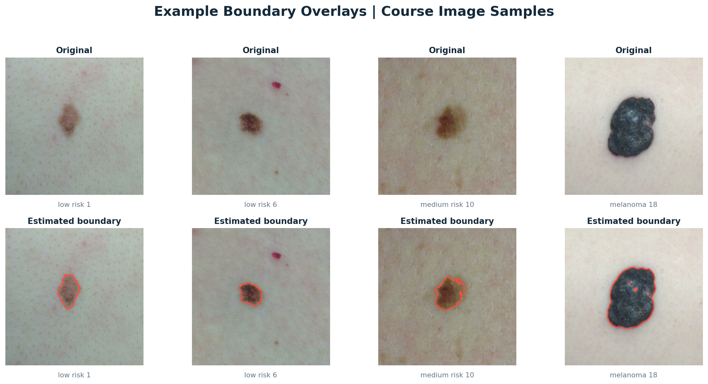
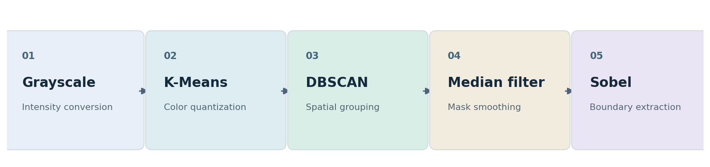
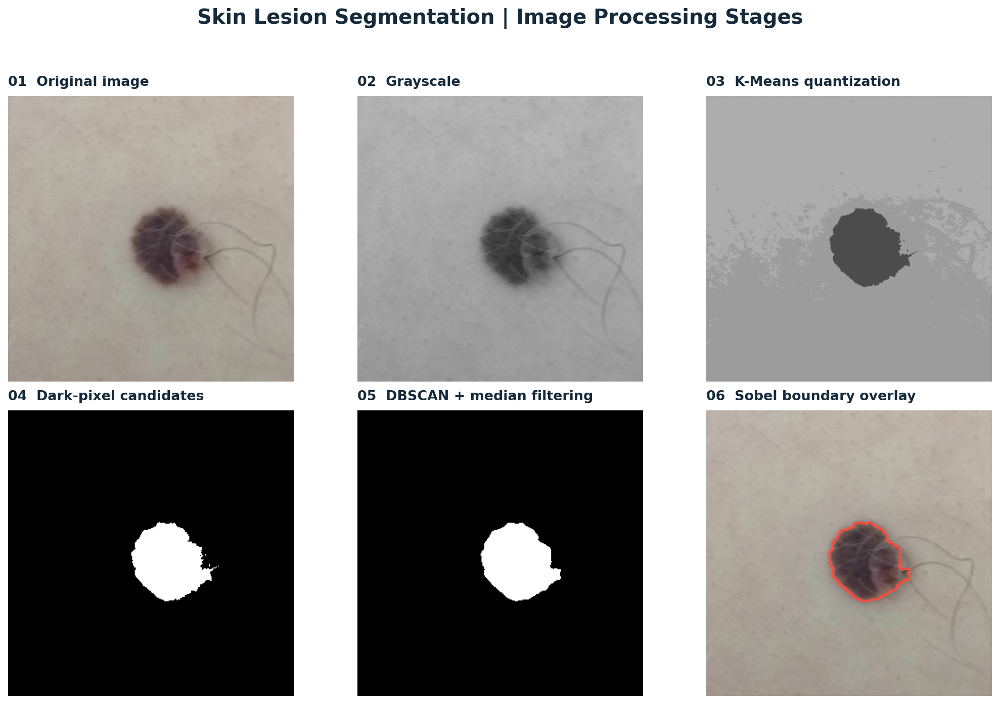

# Skin Mole Segmentation | K-Means, DBSCAN & Sobel Edge Detection

**An image-processing and unsupervised-learning pipeline that identifies candidate skin-lesion regions and extracts their boundaries using grayscale clustering, spatial density analysis, and edge detection.**

**Areas:** Computer Vision · Image Segmentation · Unsupervised Learning · Medical Image Processing  
**Techniques:** K-Means · DBSCAN · Median Filtering · Sobel Filters  
**Tools:** Python · NumPy · scikit-learn · SciPy · Matplotlib · Pillow  
**Academic context:** *ML for Health*, Politecnico di Torino · 2025/26



## Project overview

Segmenting an object from an image can involve both color-based and spatial information. This project explores a **classical computer-vision approach** to identify a dark lesion region in a skin image and trace a boundary around it.

The method uses **K-Means** to group pixel intensities, **DBSCAN** to find spatially connected regions within the dark pixel cluster, **median filtering** to smooth the segmentation mask, and **Sobel filtering** to extract the estimated edge.

This is **not a neural network** and does **not classify lesions or estimate melanoma risk**. The categories in the sample image filenames come from the course dataset, not predictions made by the program.

## Processing pipeline



1. **Grayscale conversion:** Convert the RGB input to pixel intensity values.
2. **K-Means quantization:** Cluster intensities into three representative groups and identify candidate dark pixels.
3. **DBSCAN clustering:** Group candidate pixels by spatial density, filtering isolated noise and selecting a substantial contiguous region.
4. **Median filtering:** Smooth irregularities in the candidate lesion mask.
5. **Sobel edge detection:** Compute horizontal and vertical intensity gradients to estimate the boundary.

### Step-by-step visualization



The figures above were produced using selected images from the provided course dataset. They illustrate the processing stages; no ground-truth segmentation masks were supplied for quantitative evaluation.

## Repository structure

```text
.
├── README.md
├── requirements.txt
├── src/
│   └── mole_segmentation.py       # Reusable segmentation pipeline and CLI
├── scripts/
│   └── run_demo.py                # Run the included examples
├── samples/                       # Six small course-image examples
├── docs/
│   ├── images/                    # Pipeline and sample-result figures
│   └── DATA_AND_SCOPE.md
├── original_coursework/
│   ├── lab3_experiment_final.py   # Original experiment script, unchanged
│   └── lab3_moles_for_students_annotated.py
└── tests/
    └── test_segmentation.py
```

## Getting started

Python 3.10 or later is recommended.

```bash
python -m venv .venv
# On Windows: .venv\Scripts\activate
# On macOS/Linux: source .venv/bin/activate
pip install -r requirements.txt
```

Run the included educational examples:

```bash
python scripts/run_demo.py
```

The program creates **`outputs/`** with a six-stage comparison image and an edge-overlay image for each sample. The generated output directory is excluded from Git by default.

Process any other image or a directory of images:

```bash
python src/mole_segmentation.py --input path/to/image.jpg --output-dir outputs
python src/mole_segmentation.py --input-dir path/to/moles --output-dir outputs
```

Image-dependent parameters may be tuned if the default settings do not identify the intended region:

```bash
python src/mole_segmentation.py --input path/to/image.jpg --eps 5 --min-samples 10 --median-size 5
```

`--max-side` defaults to `320` pixels to keep the pixel-coordinate DBSCAN computation practical on a laptop. The pipeline is a **reproducible companion implementation** of the original coursework's central techniques; the unmodified scripts are available in `original_coursework/`.

## Testing

```bash
python -m pytest -q
```

The tests cover image resizing, spatial-cluster selection, input validation, and mask/boundary extraction on a synthetic circular region. The bundled example images were also run through the pipeline.

## Academic context and credits

Developed as coursework for **ML for Health** at **Politecnico di Torino**, the framework introduces intensity clustering, DBSCAN, and Sobel contour extraction.

The example photographs were supplied with the course materials. They are provided to reproduce the educational demonstration; **check the original dataset's redistribution permissions before publishing the photos or screenshots in a public repository**. See [Data and scope](docs/DATA_AND_SCOPE.md).

*For educational image-processing research only. Not validated for clinical use or medical diagnosis.*
